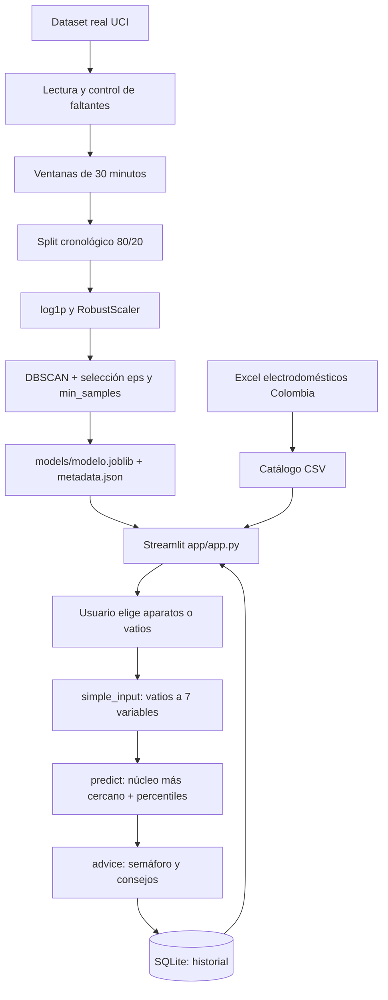

# Arquitectura EnergyWatch AI

**Capas:** presentación (`app/app.py`), lógica de negocio (`src/simple_input.py`, `src/advice.py`, `src/catalog.py`), modelo (`src/preprocessing.py`, `src/train.py`, `src/predict.py`) y persistencia (`src/database.py`).

No hay sensores en tiempo real: la pestaña Demostración reproduce mediciones históricas de prueba.
